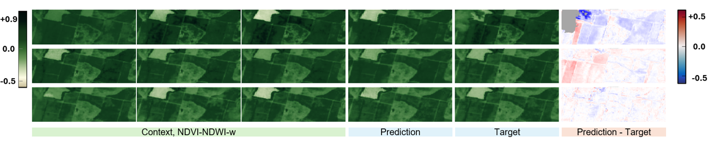

# Short-Range NDVI Forecasting



Official code repository for the paper **"From Continental Benchmarks to Local Short-Range NDVI Forecasting"**, presented at the Machine Vision for Earth Observation, Environmental Monitoring, and Climate Change (MVEO) Workshop, held in conjunction with BMVC 2026.

This work investigates the adaptation of established deep-learning architectures for **local, short-range vegetation forecasting** using Sentinel-2 observations and meteorological information. Building on the GreenEarthNet benchmark, we evaluate forecasting architectures under different prediction horizons, input representations, and prediction formulations, including direct NDVI prediction and residual prediction. The objective is to assess how models originally developed for large-scale vegetation forecasting perform when applied to local agricultural environments.

The repository contains the adapted model implementations, training and evaluation pipelines, and experiment configurations.

## Requirements

Install the Python dependencies:

```bash
pip install -r requirements.txt
```

## Dataset

The dataset used in this study is not distributed with the repository.

To prepare a dataset for a different geographical area or period, use a
Sentinel-2 download and preprocessing workflow of your choice. The data
acquisition pipeline used for the experiments is not included in this
repository.

### Data preparation

1. Define the area of interest and acquisition period.
2. Download Sentinel-2 observations from the Copernicus Data Space Ecosystem.
3. Extract the 11-band reflectance images, compute NDVI, and generate cloud-probability rasters. Filter invalid or excessively cloudy observations.
4. Reproject and align the NDVI sequence, applying the same transformations to the corresponding reflectance and cloud rasters.
5. Resize the aligned data to a height of 128 pixels, preserving the aspect ratio and ensuring consistent filenames and chronological order.

The resulting dataset should contain corresponding, chronologically ordered files in directories such as:

```text
SAT_dataset/
├── images_aligned/
└── clouds_aligned/
```

Multispectral images are expected to contain the following Sentinel-2 bands, in order:

`B01, B02, B03, B04, B05, B08, B8A, B09, B10, B11, B12`

For experiments using meteorological conditioning, weather observations must also be provided for the corresponding acquisition dates. The current data adapter expects temperature, relative humidity, precipitation, and solar irradiance.

### Dataset metadata (`base.json`)

The `ReplicateDataset` loader uses a `base.json` metadata template describing the geographical region and acquisition properties.

An example structure is:

```json
{
  "geometry": {
    "type": "MultiPolygon",
    "coordinates": [
      [
        [
          [0.0, 0.0],
          [1.0, 0.0],
          [1.0, 1.0],
          [0.0, 0.0]
        ]
      ]
    ]
  },
  "properties": {
    "acquired": "2020-01-01T00:00:00Z",
    "pixel_resolution": 10,
    "cloud_cover": 0.0,
    "provider": "sentinel2"
  }
}
```

## Training

Run training from the repository root with a selected YAML configuration:

```bash
python train.py \
  --config model_configs/simvp/simvp6M/seed=97.yaml
```

Configurations are located in:

```text
model_configs/
```

These files define model-specific parameters, dataset settings, forecasting horizons, and training options.

To reproduce a different experiment, replace the configuration path and adapt
the dataset paths and computing resources to your environment.

Model checkpoints and experiment configurations are saved in the output directory specified by the selected configuration.

## Testing and evaluation

After training, use the experiment directory containing the saved
`setting.yaml` and `checkpoints/last.ckpt` files. For the example above, the
directory is typically:

```text
experiments/bmvc/residual/ndvi_ndwi_w/replicate/simvp/simvp6M/
```

Run the standard test procedure with:

```bash
python test.py \
  --setting_root experiments/bmvc/residual/ndvi_ndwi_w/replicate/simvp/simvp6M
```

`test.py` loads the last checkpoint for each seed directory below
`--setting_root` and computes the configured benchmark score.

Run the extended NDVI evaluation with:

```bash
python eval.py \
  --setting_root experiments/bmvc/residual/ndvi_ndwi_w/replicate/simvp/simvp6M
```

`eval.py` performs the extended NDVI evaluation, including additional metrics
and context conditioning analyses.

The optional `--zeroing_nextcloud` flag replaces the next-cloud input channel
with zeros during evaluation when the selected `input_mode` contains
`nextcloud`. It measures performance without that input; it does not change
training and is not needed for the standard evaluation.

The context ablations are selected in `eval_utils.py` through
`get_ablation_variants`. They can compare, for example, normal input with
shuffled weather, shuffled acquisition dates, or randomized relative time.
These are exploratory diagnostics and are not required to reproduce the
paper's reported results.

The evaluation directory must point to the experiment outputs containing the trained models and their checkpoints, typically organized as:

```text
<EXPERIMENT_DIR>/
└── <SEED_DIR>/
    └── checkpoints/
        └── last.ckpt
```

## Citation

If you use this repository in your research, please cite:

**From Continental Benchmarks to Local Short-Range NDVI Forecasting.**  
*British Machine Vision Conference (BMVC), 2026.*

A complete BibTeX entry will be added when the publication metadata is available.

## Acknowledgments

This repository builds upon and adapts code from the following open-source projects:

- [GreenEarthNet](https://github.com/vitusbenson/greenearthnet)
- [EarthNet Models PyTorch](https://github.com/earthnet2021/earthnet-models-pytorch)

We thank the original authors for publicly releasing their implementations.

The original code has been adapted for local short-range NDVI forecasting, including modifications to model configurations, data processing, input representations, prediction targets, training procedures, and evaluation workflows.

Both upstream repositories are distributed under the MIT License. Their original copyright and license notices are preserved in `THIRD_PARTY_LICENSES/`.
